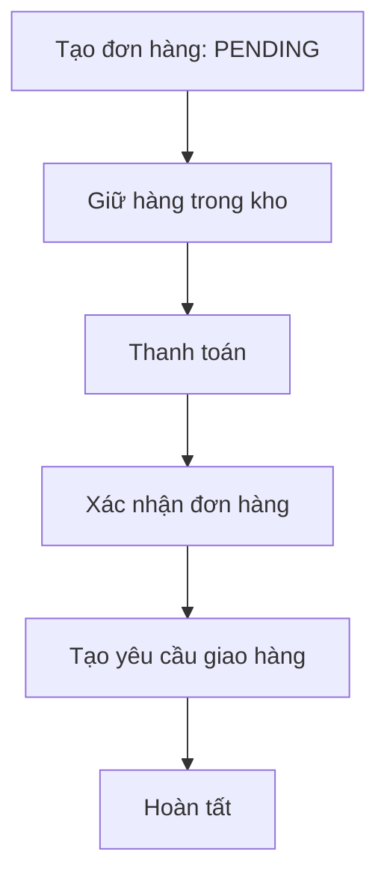
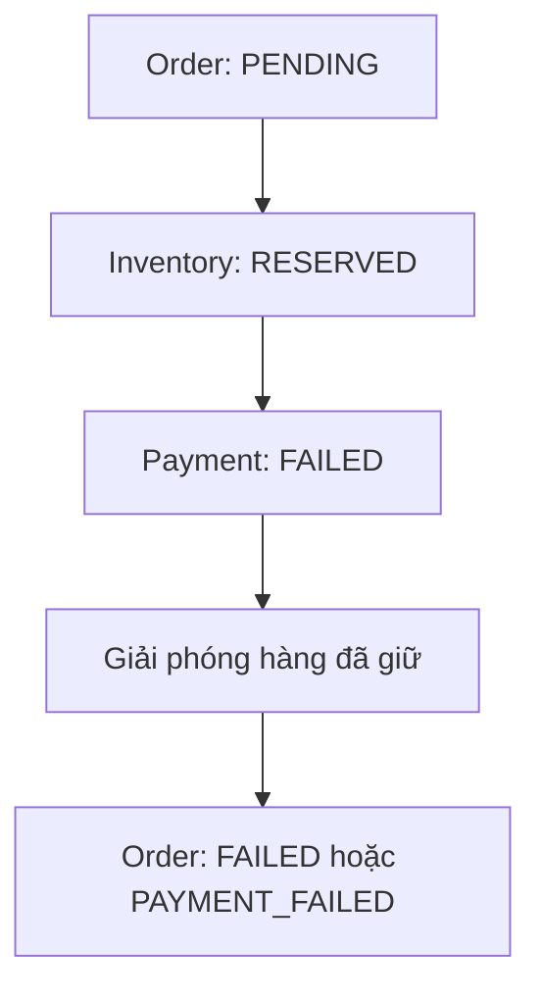
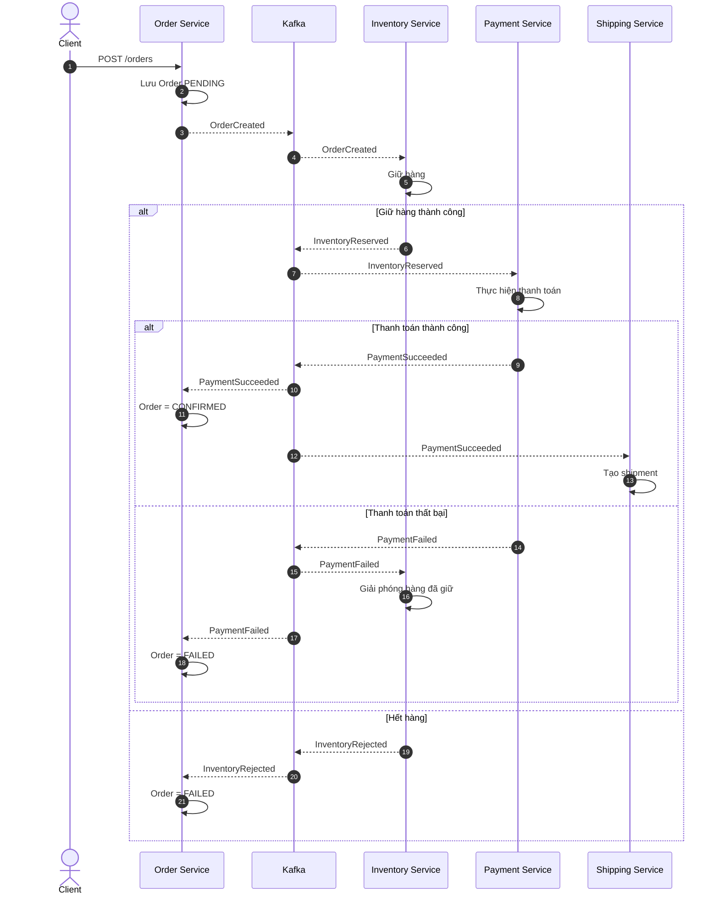
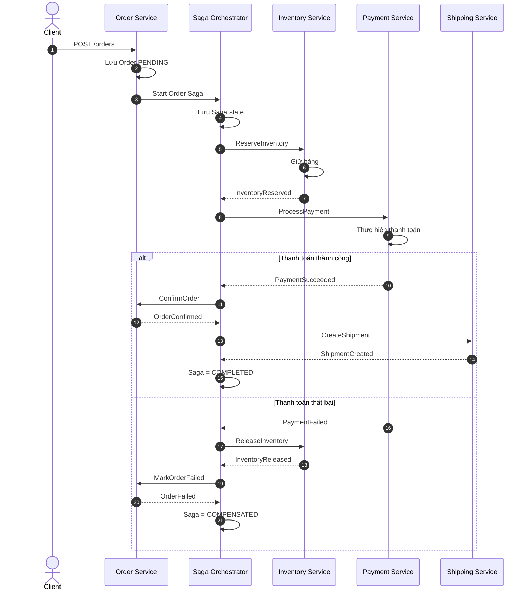
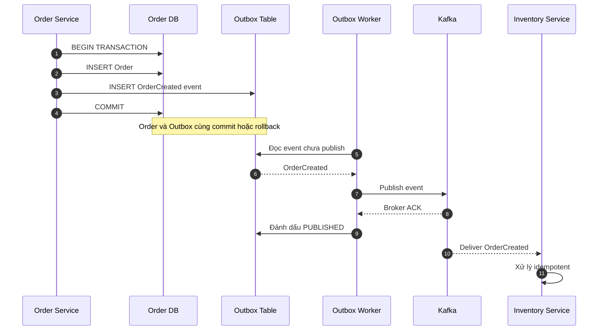
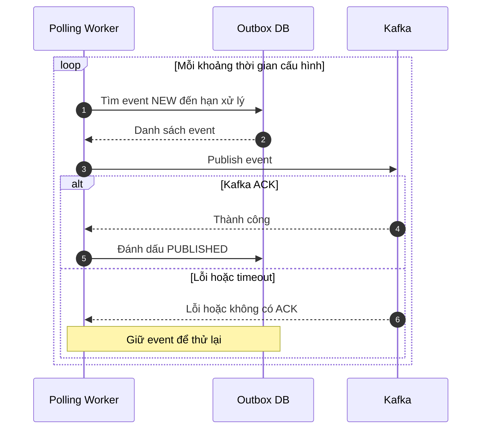
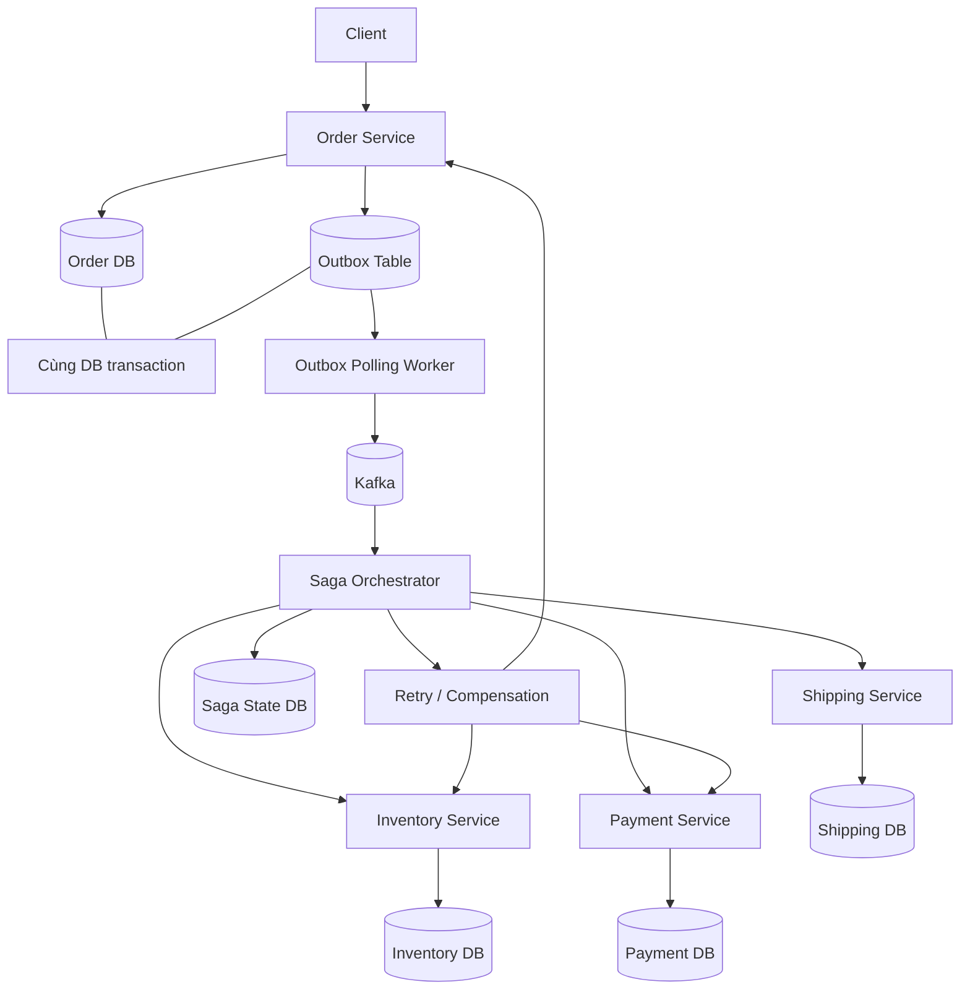

# Saga trong hệ thống thanh toán Microservices

> Ví dụ kiến trúc: Java Spring Boot, Kafka và PostgreSQL/MySQL. Tài liệu giải thích Saga Choreography, Saga Orchestration, Transactional Outbox và Job Polling trong một luồng thanh toán đơn hàng.

## Mục lục

1. [Bài toán và lý do cần Saga](#1-bài-toán-và-lý-do-cần-saga)
2. [Saga Choreography](#2-saga-choreography)
3. [Saga Orchestration](#3-saga-orchestration)
4. [So sánh và lựa chọn](#4-so-sánh-và-lựa-chọn)
5. [Transactional Outbox](#5-transactional-outbox)
6. [Job Polling](#6-job-polling)
7. [Kiến trúc kết hợp](#7-kiến-trúc-kết-hợp)
8. [Các tình huống lỗi cần xử lý](#8-các-tình-huống-lỗi-cần-xử-lý)
9. [Checklist triển khai](#9-checklist-triển-khai)
10. [Tóm tắt để phỏng vấn](#10-tóm-tắt-để-phỏng-vấn)

---

## 1. Bài toán và lý do cần Saga

Giả sử một đơn hàng cần đi qua các service:

- **Order Service:** tạo và quản lý đơn hàng.
- **Inventory Service:** kiểm tra và giữ hàng trong kho.
- **Payment Service:** thực hiện thanh toán qua cổng thanh toán.
- **Shipping Service:** tạo yêu cầu giao hàng.

Mỗi service có database riêng. Một transaction `@Transactional` thông thường chỉ quản lý transaction trong phạm vi tài nguyên mà nó được cấu hình để quản lý; nó không tự tạo ra một transaction nguyên tử bao trùm nhiều database/service độc lập.

Ví dụ lỗi:

1. Order đã được tạo.
2. Hàng đã được giữ.
3. Payment đã trừ tiền.
4. Bước tiếp theo thất bại.

Hệ thống cần có cách khôi phục trạng thái nghiệp vụ. Saga giải quyết bằng cách chia quy trình thành các **local transaction**. Nếu một bước thất bại, hệ thống có thể chạy **compensating transaction** để bù trừ các bước đã hoàn thành.

### Luồng thành công



### Luồng bù trừ ví dụ

Nếu đã giữ hàng nhưng thanh toán thất bại:



**Điểm quan trọng:** Saga không phải rollback nguyên tử như database transaction. Saga điều phối các giao dịch cục bộ và các hành động bù trừ; trong lúc xử lý, hệ thống có thể tồn tại trạng thái trung gian.

---

## 2. Saga Choreography

**Choreography** là kiểu Saga trong đó các service phối hợp thông qua event. Mỗi service thực hiện nghiệp vụ của mình, phát event kết quả và service khác lắng nghe để quyết định hành động tiếp theo. Không có một Orchestrator trung tâm quản lý toàn bộ luồng.

### Sequence diagram



### Luồng hoạt động

1. Order Service lưu đơn hàng ở trạng thái `PENDING` và phát `OrderCreated`.
2. Inventory Service nhận event, giữ hàng rồi phát `InventoryReserved` hoặc `InventoryRejected`.
3. Payment Service nhận `InventoryReserved`, thực hiện thanh toán và phát `PaymentSucceeded` hoặc `PaymentFailed`.
4. Các service liên quan lắng nghe event để cập nhật trạng thái hoặc bù trừ, ví dụ giải phóng hàng.

### Ưu điểm

- Các service không cần gọi trực tiếp nhau để điều phối toàn bộ quy trình.
- Dễ bổ sung consumer mới để phản ứng với event.
- Phù hợp với các luồng event-driven tương đối đơn giản.

### Nhược điểm

- Luồng nghiệp vụ bị phân tán giữa nhiều consumer.
- Khó quan sát tổng thể tiến trình, tìm nguyên nhân lỗi và xác định bước tiếp theo.
- Khi có nhiều nhánh lỗi, retry, timeout và compensation, logic dễ trở nên khó quản lý.

### Khi nào dùng?

Dùng khi quy trình tương đối đơn giản, các bước có thể phản ứng với event một cách tự nhiên và không cần điều phối tập trung phức tạp.

> Kafka chỉ truyền message. Kafka không tự hiểu nghiệp vụ để rollback các bước Saga đã thành công.

---

## 3. Saga Orchestration

**Orchestration** là kiểu Saga có một **Saga Orchestrator** điều phối quy trình. Orchestrator lưu trạng thái, gửi command đến service, nhận kết quả và quyết định bước tiếp theo hoặc hành động bù trừ.

### Sequence diagram



### Luồng hoạt động

1. Order Service tạo đơn hàng và khởi động Saga.
2. Orchestrator lưu trạng thái Saga.
3. Orchestrator gửi command `ReserveInventory`.
4. Khi nhận `InventoryReserved`, Orchestrator gửi `ProcessPayment`.
5. Nếu thanh toán thành công, Orchestrator yêu cầu xác nhận đơn và tạo shipment.
6. Nếu thanh toán thất bại, Orchestrator yêu cầu giải phóng hàng và cập nhật trạng thái đơn.
7. Trạng thái Saga được cập nhật theo tiến trình thực tế.

### Ví dụ trạng thái Saga

| Saga ID | Bước | Trạng thái |
|---|---|---|
| `SAGA-101` | Reserve inventory | `SUCCESS` |
| `SAGA-101` | Process payment | `FAILED` |
| `SAGA-101` | Release inventory | `PENDING` |
| `SAGA-101` | Toàn bộ Saga | `COMPENSATING` |

Sau khi bù trừ thành công, Saga có thể chuyển sang `COMPENSATED`. Nếu không thể bù trừ ngay, giữ trạng thái phù hợp như `COMPENSATION_PENDING` và retry/đưa vào quy trình xử lý thủ công.

### Ưu điểm

- Luồng nghiệp vụ tập trung và dễ đọc.
- Dễ theo dõi trạng thái từng bước.
- Dễ quản lý retry, timeout, compensation và các nhánh lỗi.
- Có thể tiếp tục các bước còn dang dở sau khi service khởi động lại nếu trạng thái Saga được lưu bền vững.

### Nhược điểm

- Tăng thêm thành phần cần phát triển và vận hành.
- Orchestrator cần có khả năng phục hồi, lưu trạng thái và chống xử lý lặp.
- Các service cần tuân thủ hợp đồng command/result rõ ràng.

### Khi nào dùng?

Phù hợp với quy trình có nhiều bước, nhiều nhánh lỗi hoặc yêu cầu theo dõi nghiệp vụ rõ ràng, chẳng hạn thanh toán, đặt vé, chuyển tiền và xử lý đơn hàng.

---

## 4. So sánh và lựa chọn

| Tiêu chí | Choreography | Orchestration |
|---|---|---|
| Điều phối | Các service phản ứng với event | Orchestrator ra lệnh theo workflow |
| Theo dõi toàn bộ luồng | Khó hơn khi luồng phức tạp | Dễ hơn nhờ trạng thái tập trung |
| Coupling | Phụ thuộc vào event/schema | Phụ thuộc vào hợp đồng command/result và Orchestrator |
| Xử lý nhiều nhánh lỗi | Dễ phân tán logic | Dễ tổ chức tập trung |
| Thành phần trung tâm | Không bắt buộc | Có Orchestrator |
| Phù hợp | Luồng đơn giản, event-driven | Luồng nhiều bước, cần kiểm soát tiến trình |

Với bài toán thanh toán có giữ kho, charge/refund, timeout và giao hàng, thường nên cân nhắc **Orchestration** để dễ kiểm soát trạng thái và compensation.

Hai kiểu này không loại trừ các cơ chế tin cậy khác. Cả hai đều có thể sử dụng Kafka, Outbox, retry, idempotency và dead-letter handling.

---

## 5. Transactional Outbox

### Vấn đề Outbox giải quyết

Giả sử code tạo đơn hàng như sau:

```java
@Transactional
public Order createOrder(CreateOrderRequest request) {
    Order order = orderRepository.save(new Order(request));
    kafkaTemplate.send(
        "order-events",
        new OrderCreated(order.getId())
    );
    return order;
}
```

`@Transactional` mặc định quản lý transaction database; nó không tự đảm bảo database và Kafka cùng commit hoặc cùng rollback như một distributed transaction.

Có hai lỗi điển hình:

1. **DB commit thành công, Kafka publish thất bại:** đơn hàng tồn tại nhưng service khác không nhận được event.
2. **Kafka publish thành công, DB rollback:** consumer nhận event của đơn hàng không được lưu thành công.

### Cách giải quyết

Transactional Outbox lưu bản ghi nghiệp vụ và event cần phát trong **cùng một database transaction**. Một worker hoặc CDC sau đó đọc Outbox và phát event ra Kafka.



### Ví dụ SQL

```sql
BEGIN;

INSERT INTO orders (id, status)
VALUES ('ORD-101', 'PENDING');

INSERT INTO outbox_events
    (id, aggregate_id, event_type, payload, status)
VALUES
    ('EVT-101', 'ORD-101', 'OrderCreated',
     '{"orderId":"ORD-101"}', 'NEW');

COMMIT;
```

Nếu transaction rollback, cả đơn hàng lẫn event Outbox đều rollback. Nếu transaction commit, event đã được lưu bền vững trong DB, kể cả khi Kafka đang gặp sự cố.

### Bảng Outbox mẫu

| Cột | Ý nghĩa |
|---|---|
| `id` | ID duy nhất của event |
| `aggregate_id` | ID đơn hàng hoặc aggregate |
| `event_type` | Ví dụ `OrderCreated` |
| `payload` | Payload event |
| `status` | Ví dụ `NEW`, `PUBLISHED` |
| `created_at` | Thời điểm tạo |
| `published_at` | Thời điểm publish thành công, nếu có |

### Outbox không đảm bảo điều gì?

Outbox **không tự đảm bảo message chỉ được gửi đúng một lần**.

Ví dụ worker publish thành công nhưng chết trước khi đánh dấu `PUBLISHED`. Khi khởi động lại, worker có thể gửi lại event. Vì vậy consumer phải idempotent, thường dùng `eventId` duy nhất và bảng inbox/deduplication hoặc một cơ chế tương đương.

Outbox cũng không thay thế Saga. Outbox giải quyết việc phát event đáng tin cậy sau khi ghi DB; Saga giải quyết việc điều phối nghiệp vụ xuyên nhiều service.

---

## 6. Job Polling

### Job Polling là gì?

Job Polling là cơ chế chạy định kỳ để tìm các công việc chưa xử lý hoặc chưa hoàn thành, rồi thực hiện chúng.

Trong Outbox pattern, một worker có thể polling bảng Outbox mỗi khoảng thời gian nhất định để tìm event chưa publish.

### Sequence diagram



### Quy trình mẫu

1. Worker chạy định kỳ, ví dụ mỗi 1 giây.
2. Truy vấn event có trạng thái `NEW`.
3. Claim/lock các bản ghi để tránh nhiều worker xử lý cùng một event không có kiểm soát.
4. Gửi event lên Kafka.
5. Khi nhận ACK phù hợp, cập nhật `PUBLISHED`.
6. Khi lỗi, retry theo backoff; sau số lần vượt ngưỡng có thể chuyển sang trạng thái cần xử lý riêng và cảnh báo vận hành.

Tần suất 1 giây chỉ là ví dụ. Cần chọn theo yêu cầu độ trễ, tải DB và kích thước batch.

### Outbox và Job Polling khác nhau thế nào?

| Tiêu chí | Transactional Outbox | Job Polling |
|---|---|---|
| Bản chất | Pattern lưu event an toàn cùng dữ liệu nghiệp vụ | Cơ chế tìm và xử lý công việc định kỳ |
| Nơi thực hiện | Bảng trong database nghiệp vụ | Worker/job chạy trong ứng dụng hoặc scheduler |
| Vai trò | Lưu ý định phát event bền vững | Tìm event đang chờ và thực hiện publish |
| Có tự publish Kafka không? | Không; cần worker hoặc CDC | Có thể, nếu job được thiết kế để publish |
| Khi Kafka lỗi | Event vẫn được giữ trong Outbox | Job thử lại theo chính sách retry |

Job Polling không bắt buộc chỉ dùng cho Outbox. Nó cũng có thể phục vụ việc retry thanh toán, xử lý đơn hàng hết hạn, kiểm tra giao dịch treo hoặc các tác vụ định kỳ khác.

### Polling so với CDC

Một lựa chọn khác là dùng Change Data Capture (CDC), ví dụ đọc thay đổi database log để đưa Outbox event sang Kafka. CDC có thể giảm việc polling liên tục vào bảng, nhưng cần vận hành connector và quản lý offset/schema. Polling thường dễ bắt đầu hơn; CDC có thể phù hợp khi throughput hoặc độ trễ đòi hỏi khác.

---

## 7. Kiến trúc kết hợp

Ví dụ kết hợp Orchestration + Outbox + Polling:



### Luồng tổng thể

1. Order Service tạo đơn hàng `PENDING`, đồng thời ghi `OrderCreated` vào Outbox trong cùng transaction.
2. Polling Worker đọc Outbox và publish event lên Kafka.
3. Saga Orchestrator nhận event, tạo/cập nhật trạng thái Saga và gửi command đến Inventory Service.
4. Inventory Service giữ hàng, lưu kết quả và trả kết quả về Orchestrator.
5. Orchestrator tiếp tục yêu cầu Payment Service thanh toán.
6. Nếu thanh toán thành công, tiếp tục xác nhận đơn và tạo shipment.
7. Nếu thất bại, Orchestrator quyết định retry, chờ xác minh hoặc chạy compensation.
8. Các service cũng có thể dùng Outbox cho event kết quả nếu cần đảm bảo event được phát sau khi local transaction commit.

**Lưu ý:** Nếu dùng Kafka để gửi command và nhận result, cần xác định rõ correlation ID, Saga ID, command ID, timeout và cách cập nhật state. Nếu gọi HTTP trực tiếp, vẫn cần xử lý timeout, retry và idempotency; Outbox không tự giải quyết các vấn đề đó.

---

## 8. Các tình huống lỗi cần xử lý

### Tình huống 1: DB commit nhưng Kafka lỗi

**Cách xử lý:** Event vẫn nằm trong Outbox. Worker retry khi Kafka hoạt động trở lại. Không cần tạo lại đơn hàng.

### Tình huống 2: Kafka nhận event nhưng worker chết trước khi đánh dấu `PUBLISHED`

**Cách xử lý:** Event có thể được gửi lại. Consumer nên deduplicate theo `eventId`, ví dụ dùng bảng Inbox có unique constraint để bảo vệ việc xử lý lặp.

### Tình huống 3: Payment timeout

Timeout không đồng nghĩa thanh toán thất bại. Cổng thanh toán có thể đã charge thành công nhưng response bị mất.

**Cách xử lý:**

- Đánh dấu giao dịch `PAYMENT_UNKNOWN` hoặc trạng thái tương đương.
- Dùng idempotency key ổn định cho lần thử của cùng một nghiệp vụ thanh toán.
- Truy vấn cổng thanh toán hoặc chờ webhook để xác minh.
- Chỉ quyết định retry charge, tiếp tục Saga hay refund sau khi xác định trạng thái phù hợp.

Không charge lại hoặc refund mù quáng khi chưa rõ kết quả giao dịch.

### Tình huống 4: Compensation thất bại

Ví dụ payment thất bại nhưng Inventory Service tạm thời không giải phóng được hàng.

**Cách xử lý:** Giữ Saga ở trạng thái như `COMPENSATION_PENDING`, retry có giới hạn với backoff, phát cảnh báo và hỗ trợ can thiệp vận hành nếu vượt ngưỡng. Không đánh dấu Saga đã bù trừ thành công trước khi có kết quả xác nhận.

### Tình huống 5: Nhiều worker polling cùng một event

**Cách xử lý:** Sử dụng cơ chế claim/lease hoặc khóa bản ghi phù hợp với database, batch có giới hạn và thiết kế idempotent. Không giả định chỉ có một worker trừ khi hệ thống thực sự đảm bảo điều đó.

### Tình huống 6: Consumer xử lý message nhiều lần

**Cách xử lý:** Lưu `eventId` đã xử lý với unique constraint, hoặc dùng một cơ chế deduplication tương đương. Việc ghi nhận đã xử lý và cập nhật dữ liệu nghiệp vụ nên được bảo vệ trong cùng local transaction khi có thể.

---

## 9. Checklist triển khai

### Saga Orchestrator

- [ ] Lưu trạng thái Saga bền vững.
- [ ] Có `sagaId`, `orderId`, `correlationId` và ID cho command/event.
- [ ] Định nghĩa trạng thái cho từng bước, timeout và retry.
- [ ] Xác định compensation tương ứng với từng bước đã hoàn thành.
- [ ] Có cách tiếp tục các Saga dang dở sau restart.
- [ ] Có giám sát, log, metric và cảnh báo cho Saga bị treo.

### Transactional Outbox

- [ ] Ghi nghiệp vụ và Outbox trong cùng transaction database.
- [ ] Có ID duy nhất cho từng event.
- [ ] Worker chỉ đánh dấu publish sau khi nhận ACK phù hợp.
- [ ] Xử lý trường hợp publish thành công nhưng cập nhật trạng thái thất bại.
- [ ] Có chính sách retry, backoff, cảnh báo và dọn dữ liệu cũ.
- [ ] Xem xét thứ tự event theo aggregate nếu nghiệp vụ yêu cầu.

### Job Polling

- [ ] Chọn chu kỳ polling và batch size phù hợp.
- [ ] Ngăn nhiều worker claim cùng một bản ghi không kiểm soát.
- [ ] Có retry/backoff và xử lý lỗi kéo dài.
- [ ] Theo dõi số event tồn đọng và tuổi của event cũ nhất.
- [ ] Thiết kế để chạy lại an toàn.

### Payment và Consumer

- [ ] Dùng idempotency key cho yêu cầu charge/refund.
- [ ] Xử lý trạng thái `UNKNOWN` khi timeout.
- [ ] Có cơ chế xác minh giao dịch qua API/webhook/đối soát.
- [ ] Consumer chống xử lý event lặp.
- [ ] Không giả định Kafka, HTTP hoặc webhook chỉ giao một lần.

---

## 10. Tóm tắt để phỏng vấn

- **Saga:** Quản lý một nghiệp vụ phân tán bằng nhiều local transaction và compensation.
- **Choreography:** Các service phối hợp qua event; phù hợp với luồng đơn giản nhưng có thể khó theo dõi khi quy trình phức tạp.
- **Orchestration:** Một Orchestrator quản lý tiến trình, ra lệnh và điều phối compensation; phù hợp với luồng nhiều bước, nhiều nhánh lỗi.
- **Transactional Outbox:** Lưu event cùng dữ liệu nghiệp vụ trong cùng DB transaction để tránh mất ý định publish khi DB đã commit.
- **Job Polling:** Định kỳ tìm và xử lý công việc chưa hoàn thành, chẳng hạn publish event từ Outbox.
- **Idempotency:** Giúp xử lý lặp mà không lặp tác động nghiệp vụ.
- **Compensation:** Là hành động nghiệp vụ để bù trừ một bước đã thành công, không phải rollback database xuyên nhiều service.

### Công thức ghi nhớ

> **Saga quản lý quy trình; Outbox lưu ý định phát event an toàn; Job Polling tìm việc cần xử lý; Idempotency bảo vệ khi xử lý lặp; Compensation khôi phục trạng thái nghiệp vụ khi quy trình thất bại.**
